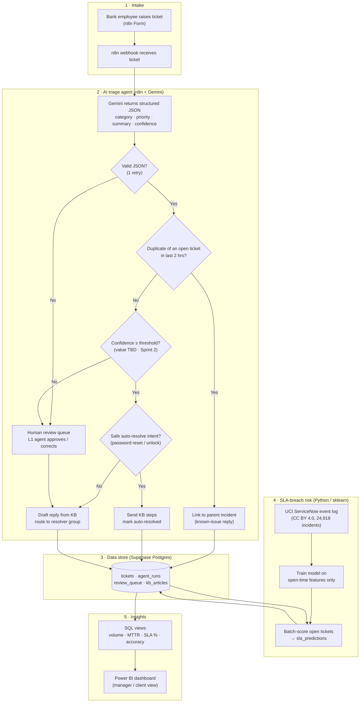

# AI Service Desk Agent + SLA Analytics

An AI triage agent with human review, an SLA-breach risk model and a Power BI dashboard for a bank's outsourced IT service desk.

> **Disclaimer:** Nimbus IT Services and FinServ Bank are fictional. This is a portfolio project by Shikhar Nigam (IIM MBA 2025–27). All data is public (UCI, Kaggle) or synthetic.

**Status:** Sprint 0 done (BRD and SRS v1.0 signed off; v1.1 adds Sprint 1 EDA updates) · Sprints 1–3 in progress

---

## Problem
Nimbus IT Services runs FinServ Bank's L1 IT service desk: about 5,000 tickets a month at ₹350 per ticket. Every ticket is triaged by hand (about 6 minutes each), and slow or wrong triage causes SLA breaches. At 88% SLA compliance, Nimbus loses 5% of the monthly invoice (₹87,500) in service credits.

## Solution
- **AI triage agent** (n8n + Gemini): category, priority, summary and confidence as structured JSON
- **Human review queue** (Supabase) for low-confidence tickets, with a full audit trail
- **KB-grounded draft replies**, duplicate detection, and auto-resolve for password resets *(Could-have)*
- **SLA-breach risk model** (scikit-learn) trained on a real ServiceNow event log, using open-time features only
- **Power BI dashboard:** volume, MTTR, SLA %, AI accuracy, service-credit exposure

## Impact (business case, base case)

| Item | Value |
|---|---|
| Monthly benefit | ₹2.99 lakh (labour capacity + service credits avoided) |
| One-time build / monthly run | ₹6 lakh / ₹25,000 |
| Payback | ≈ 2.2 months |
| 12-month ROI | ≈ 299% (low case ≈ 41%) |

*These are planning assumptions, not measured results. Sprint 3 compares actual against planned figures.*

## Architecture



## Demo
*GIF coming in Sprint 3.*

## Results

| Metric | Target | Actual |
|---|---|---|
| Category accuracy (100-ticket eval set) | ≥ 85% | *Sprint 2* |
| Priority accuracy | ≥ 80% | *Sprint 2* |
| Share of tickets sent to human review | ≤ 30% | *Sprint 2* |
| Prompt-injection tests passed | 100% | *Sprint 2* |
| Breach-model recall | Set after EDA | *Sprint 1* |

## Business documents
- [Business Requirements Document (BRD)](docs/BRD.md) · [PDF](docs/pdf/BRD.pdf): problem, objectives, stakeholder map, RACI, business case with sensitivity, risks
- [Software Requirements Specification (SRS)](docs/SRS.md) · [PDF](docs/pdf/SRS.pdf): 19 functional and 13 non-functional requirements, acceptance criteria, traceability matrix
- [Decision log](docs/decision-log.md): every project decision, with the options considered and the reason

Method: Hybrid SDLC, with requirements signed off upfront and then 1-day build sprints.

## Repo structure
```
docs/       BRD, SRS, decision log, flowchart
data/       raw/ (not committed) · sample/ (small samples)
ml/         EDA, breach-model training, batch scoring
n8n/        exported agent workflow (JSON)
sql/        schema, seed data, reporting views
eval/       100-ticket evaluation set, results, edge tests
powerbi/    dashboard (.pbix) and screenshots
```

## Tech stack
n8n 2.47.4 (Docker) · Gemini 3.5 Flash Lite (fallback 3.1 Flash Lite) · Supabase Postgres · Python, pandas, scikit-learn · Power BI Desktop

## How to run
1. Clone the repo and copy `.env.example` to `.env`, then fill in your own keys. `.env` is git-ignored.
2. Set up Python:
   ```bash
   python3 -m venv .venv && source .venv/bin/activate
   pip install -r requirements.txt
   ```
3. Download the datasets (see below) into `data/raw/`.
4. More steps are added sprint by sprint (Supabase schema, n8n import, model training).

## Data and credits
- **UCI "Incident management process enriched event log"**, UCI Machine Learning Repository, licensed CC BY 4.0. *Citation and authors: to be copied from the UCI page.*
- **Kaggle "IT Service Ticket Classification"**: CC0 *(to confirm on download)*. *Link to be added.*

Raw files are not committed. Only small samples and the 100-ticket evaluation set are.

## Licence
MIT, covering code and documents. Datasets keep their own licences.
