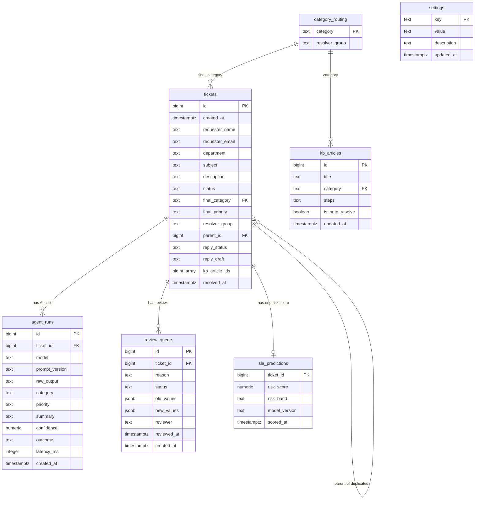

# sql/ — Supabase database (SRS §5)

Run the three files in order in the Supabase SQL Editor. All are safe to re-run.

| Order | File | What it does |
|---|---|---|
| 1 | `01_schema.sql` | Creates the 7 tables, their links, value rules (CHECK) and indexes |
| 2 | `02_security.sql` | Turns on row-level security for every table (NFR-04) |
| 3 | `03_seed.sql` | Adds config rows to `settings` (NFR-11). `category_routing` is a TODO for Sprint 2 |
| — | `check_connection.py` | Lists every table with its row count and RLS status |

Check from your machine (needs `SUPABASE_DB_URL` in `.env`):

```bash
.venv/bin/python sql/check_connection.py
```

## Tables



## Allowed values

| Column | Values |
|---|---|
| `tickets.status` | new, triaged, in_review, auto_resolved, resolved, closed |
| `tickets.final_priority` | P1, P2, P3, P4 |
| `tickets.reply_status` | draft, sent |
| `agent_runs.outcome` | ok, retry, fallback, failed |
| `review_queue.status` | pending, approved, corrected |
| `review_queue.reason` | low_confidence, invalid_output, ai_unavailable, edge_case |
| `sla_predictions.risk_band` | High, Medium, Low |

## Notes

- **Security:** RLS is on with no policies, so the public key sees nothing. n8n and Python use the service key or the database login; keys live only in `.env`.
- **Categories:** `tickets.final_category` and `kb_articles.category` must exist in `category_routing`, which is empty until the Kaggle names are verified (Sprint 2).
- **Free tier:** Supabase pauses a project after about a week without use. Restore it from the dashboard before a demo.
- **Changing a table later:** `IF NOT EXISTS` skips tables that already exist, so column changes need an `ALTER TABLE` statement.
